# Opentrons desktop app automated tests

What the desktop app tests actually do, written so someone outside the test code can follow the logic. Charts read left to right. The on-device screen is in [TEST_FLOWS_ODD.md](TEST_FLOWS_ODD.md).

Each step is one of three kinds:

- **Checks an outcome.** The test performs the action and requires a visible result.
- **Opens the screen.** The test reaches the control or takes a screenshot. It does not complete the action.
- **Stops early.** The test is skipped, or it passes because the hardware or data is absent.

`tests/test_ui_runner.py` checks the internal test runner, not the Opentrons app. `tests/compliance/example_test.py` only pauses so someone can record steps by hand.

## How to paste this

**Confluence.** Create a page and paste this file. If the page has a Markdown option, use that so the tables and headings format themselves. Each diagram is a Mermaid block: in Confluence, insert a Mermaid macro and paste only the lines between the fences.

**Google Docs.** Paste the whole file. Headings and tables come through as text. Mermaid stays as a code block. To turn a diagram into a picture, copy one block into [mermaid.live](https://mermaid.live), export PNG or SVG, and insert the image under that heading.

## What is still open

| Area | What the automation does today | Still open |
| --- | --- | --- |
| Protocol run | Creates a run, screenshots tabs, logs status and timer, expands each Setup step | Setup is not finished. Start run is not clicked. A run is not watched through success or failure |
| ABR robots | Clicks Start run and stops when Pause appears | The protocol is left running. Finish, pass, and fail are not watched |
| Desktop protocol delete | Opens Delete and clicks Cancel | The protocol stays on the computer |
| Update robot software | Checks that Browse file system is on screen | No file is chosen. No update runs |
| Robot server reinstall | Checks that Reinstall or Up to date is on screen | Reinstall is not started |
| Jupyter | Checks that Launch is on screen | The notebook is not opened |
| About calibration, Networking | Screenshot of the tab | The contents are not judged pass or fail |
| File capacity | Opens File manager, reads the storage meter, screenshots Robot Storage | Delete selected is not exercised |
| Show in folder | Clicks the menu item | Finder is not checked |
| Reanalyze | Clicks the menu item | Analysis is not waited on |
| App language | The test exists and is always skipped | The helper is not built |
| Pause when the door opens | The test exists and is always skipped | OT-2 only. Flex is not exercised |
| Hardware that is not attached | That card is skipped and the suite continues | A missing pipette or module does not fail the run |
| Plate reader, stacker, magnetic block | Placed on the deck during empty-deck setup | No card controls are exercised |
| Gripper calibration | Status can be listed | The wizard itself is still manual |
| Home gantry | Clicks Home gantry while it is enabled | Homing is not waited on |

## Order the desktop suite has to run

Home gantry has to happen before any protocol is loaded on the robot. Device Reset restarts the robot, so it stays last in Robot Settings.

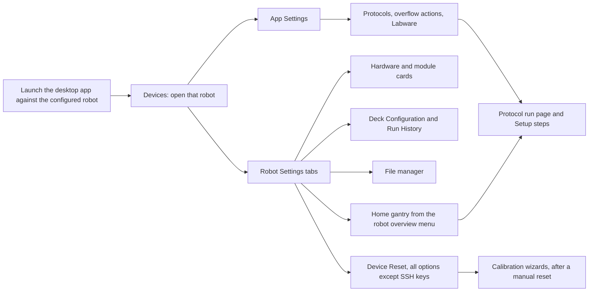

In words: open the robot, then Robot Settings. From there the suite can home the gantry, exercise cards, review the deck and run history, and open File manager. Device Reset is last in that group. App Settings and Protocols can run from the robot detail page. The protocol run page waits until Home gantry has already run. Calibration wizards run after a manual reset.

## Devices and robot detail

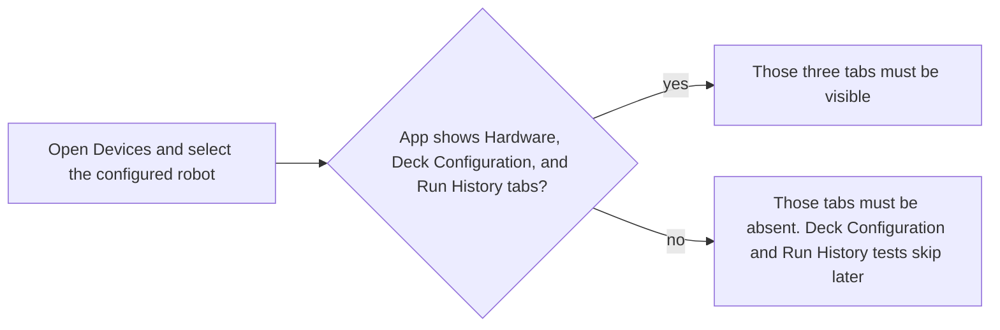

In words: open Devices, select the configured robot, and check whether the newer three-tab layout is present. Older layouts skip Deck Configuration and Run History later.

## Robot Settings

```mermaid
flowchart LR
  open["Open Robot Settings once for the session"] --> about["About Calibration: screenshot only"]
  about --> pip["Pipette Calibrations: list each pipette status, including Not calibrated. A missing calibration does not fail"]
  pip --> net["Networking: tab is selected, then screenshot"]
  net --> cam["Camera: turn Camera Status on, toggle Live video and Error image capture, screenshot"]
  cam --> name["Robot name: rename to name plus TEST, then rename back. A leftover TEST name is restored first"]
  name --> ver["Robot server version: text must look like v1 or Unknown"]
  ver --> door["Pause when door opens: always skipped on Flex"]
  door --> home["Overview menu, Home gantry: click only if the button is enabled"]
  home --> back["Return to Robot Settings"]
  back --> jup["Jupyter: Launch button is visible. Notebook is not opened"]
  jup --> upd["Update robot software: Browse file system is visible. No file is chosen"]
  upd --> rei["Reinstall or Up to date must be visible. Reinstall is not started"]
  rei --> analytics["Camera again: turn status on and toggle the same two usage switches"]
  analytics --> reset["Device Reset: select every option, clear SSH keys, confirm restart, land on Devices"]
```

In words: one Robot Settings session walks Calibration, Networking, and Camera, then renames the robot and restores the original name. Server version must read like a version or Unknown. Door-open pause is skipped on Flex. Home gantry is clicked from the overview menu, then the session returns to settings. Jupyter, software update, and reinstall are presence checks. Camera usage is toggled again. Device Reset selects every option except SSH keys, confirms, and lands on Devices.

## File manager

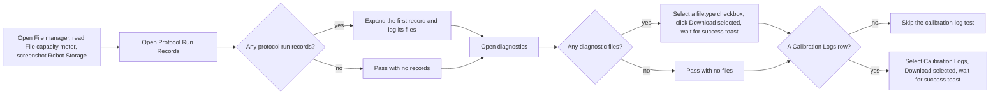

In words: File manager opens and reads the storage meter, then lists run records and expands the first one when any exist. Diagnostics checks a filetype and downloads it. Calibration Logs is downloaded when listed; otherwise that test skips.

## Hardware cards

Each card is skipped when that hardware is missing or its menu is disabled. The suite still passes.

```mermaid
flowchart LR
  detail["Already on the robot"] --> dual{"96-channel combined left plus right card?"}
  dual -->|yes| both["Open About pipette and read serial and firmware"]
  dual -->|yes| skipRight["Right-pipette test skips"]
  dual -->|no| left{"Left mount present?"}
  left -->|yes| leftAbout["About pipette for the left mount"]
  left -->|no| skipLeft["Skip left pipette"]
  dual -->|no| right{"Right mount present?"}
  right -->|yes| rightAbout["About pipette for the right mount"]
  right -->|no| skipRight2["Skip right pipette"]
  both --> grip
  leftAbout --> grip
  skipLeft --> grip
  rightAbout --> grip
  skipRight2 --> grip
  grip{"Gripper extension mount present?"}
  grip -->|yes| gripAbout["About gripper, read serial and firmware"]
  grip -->|no| skipGrip["Skip gripper"]
  gripAbout --> tc
  skipGrip --> tc
  tc{"Thermocycler card present?"}
  tc -->|yes| tcDo["Close lid, set lid to 80 C, set block to 60 C"]
  tc -->|no| skipTc["Skip thermocycler"]
  tcDo --> hs
  skipTc --> hs
  hs{"Heater-Shaker card present?"}
  hs -->|yes| hsDo["Set 40 C, test shake, toggle latch"]
  hs -->|no| skipHs["Skip heater-shaker"]
  hsDo --> temp
  skipHs --> temp
  temp{"Temperature module card present?"}
  temp -->|yes| tempDo["Set module to 4 C"]
  temp -->|no| skipTemp["Skip temperature module"]
  tempDo --> lights
  skipTemp --> lights
  lights{"Lights switch on screen?"}
  lights -->|yes| toggle["Click the switch and print before and after. A failed toggle does not fail the test"]
  lights -->|no| skipLights["Skip lights"]
```

In words: a 96-channel pipette uses one combined card and skips the separate right-mount test. Otherwise each mount is opened only when it is present. Gripper, thermocycler, heater-shaker, and temperature module follow the same present-or-skip rule. Thermocycler closes the lid and sets lid 80 C and block 60 C. Heater-shaker sets 40 C, runs a test shake, and toggles the latch. Temperature module sets 4 C. Lights are clicked when the switch is on screen. Plate reader and stacker cards can be discovered in code, and their exercise does nothing.

## Deck Configuration and Run History

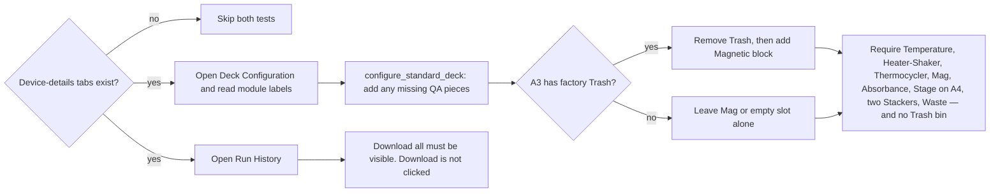

In words: both tests skip on the older single-page robot layout. Deck Configuration mirrors the ODD flow: add any missing standard QA pieces, clearing factory-default Trash bin on A3 before Mag, plus deck expansion (Stage) on A4. Those labels are required, including two stackers and no Trash bin. Run History only checks that Download all is visible.

## App Settings

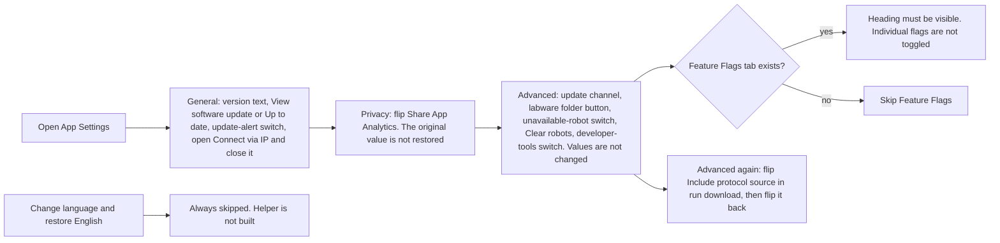

In words: General checks version, update status, the alert switch, and opens then closes Connect via IP. Privacy flips analytics and leaves it flipped. Advanced checks that the controls are on screen. Feature Flags is a heading check, or a skip when the tab is absent. The protocol-source download switch is flipped and restored. Language change is always skipped.

## Protocols, actions, and Labware

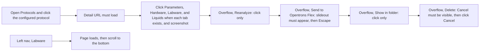

In words: the configured protocol must open on its detail URL. Present detail tabs are clicked and screenshotted. Reanalyze and Show in folder are clicks only. Send to Flex must show its slideout, which is then closed. Delete is opened and cancelled. Labware opens from the left nav and scrolls to the bottom.

## Protocol run and Setup

This path requires Home gantry to have already run.

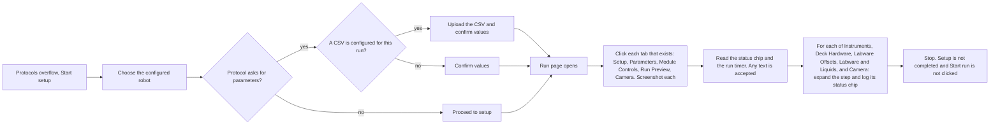

In words: Start setup, pick the robot, and confirm parameters when the protocol has them, including a CSV when one is configured. The run page tabs are screenshotted. Status and timer are read and any text is accepted. Each Setup step is expanded and its status is logged. The run is not started. If a run is already open, the Setup tests reuse it.

## Calibration wizards

These move the robot. Reset the robot by hand before this suite. Gripper calibration is still manual.

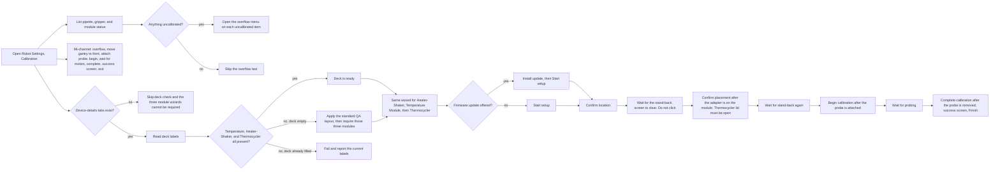

In words: Calibration lists pipette, gripper, and module status, and opens overflow menus only for items that are not calibrated. The 96-channel wizard runs from overflow through probe attach, motion, complete, and exit. Module wizards first require Temperature, Heater-Shaker, and Thermocycler on the deck: an empty deck is filled, a deck that is already filled but missing one of those three fails. Heater-Shaker, Temperature Module, and Thermocycler then share one wizard: firmware if offered, start setup, confirm location, wait through motion, confirm placement, wait through motion, begin with the probe attached, wait for probing, complete after the probe is removed, and finish on the success screen.

## ABR start-run

ABR2 and ABR4 share this path. ABR2 also uploads `2_samplevols.csv`. Each test is allowed 15 minutes. It stops when the run is active.

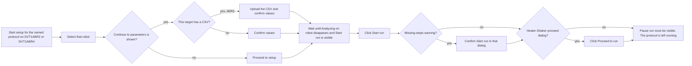

In words: start the named protocol on DVT1ABR2 or DVT1ABR4, select that robot, and upload the CSV only for ABR2. Wait until analysis finishes, click Start run, confirm the missing-steps or heater-shaker dialogs when they appear, and stop once Pause is visible.

## Compliance login

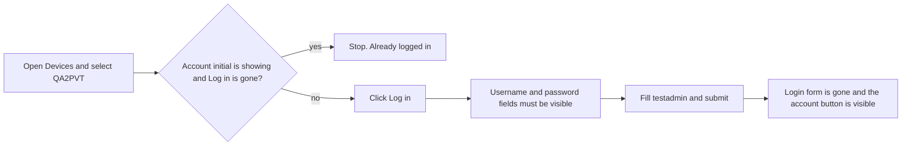

In words: open QA2PVT. If the account button is already showing, stop. Otherwise open Compliance Ready login, fill the test admin user, submit, and require the account button.
