# Opentrons on-device display automated tests

What the Flex on-device screen test actually does, written so someone outside the test code can follow the logic. Charts read left to right. The desktop app is in [TEST_FLOWS_APP.md](TEST_FLOWS_APP.md).

Each step is one of three kinds:

- **Checks an outcome.** The test performs the action and requires a visible result.
- **Opens the screen.** The test reaches the control. It does not complete the action.
- **Stops early.** The test is skipped, or it passes because the data is absent.

## How to paste this

**Confluence.** Create a page and paste this file. If the page has a Markdown option, use that so the tables and headings format themselves. Each diagram is a Mermaid block: in Confluence, insert a Mermaid macro and paste only the lines between the fences.

**Google Docs.** Paste the whole file. Headings and tables come through as text. Mermaid stays as a code block. To turn a diagram into a picture, copy one block into [mermaid.live](https://mermaid.live), export PNG or SVG, and insert the image under that heading.

## What is still open

| Area | What the automation does today | Still open |
| --- | --- | --- |
| Delete a protocol | Deletes the bottom healthy protocol and counts the cards afterward | This is irreversible. The robot needs a disposable protocol |
| Pin a protocol | Pins the open protocol, or closes the max-pins alert and continues | Unpin, and what happens after the pin limit, are not exercised further |
| Instruments | Page objects exist | No test opens Instruments or a mount |
| Settings | Page objects exist | No test opens Settings |
| Overflow menu | Page objects exist for home gantry, restart, shutdown, and deck configuration | No test opens that menu |
| Start setup | The button must be visible on protocol details | Setup is not started and a run is not started |

## Protocol flows

One test covers dashboard, the protocols list, sorting, setup details, pin, and delete. It deletes a protocol.

```mermaid
flowchart LR
  alive["On-device screen is open"] --> dash["Open the dashboard: Run again or No recent runs"]
  dash --> list["Open Protocols: sort buttons, at least one card, Quick transfer"]
  list --> sort["Click Protocol Name, Last Run, and Date Added, each twice"]
  sort --> healthy["Open the first card that is not a failed analysis"]
  healthy --> details["Start setup is visible. Click each detail tab that exists"]
  details --> pin{"Unpin is already showing?"}
  pin -->|yes| pinned["Treat it as already pinned"]
  pin -->|no| clickPin["Click Pin protocol"]
  clickPin --> max{"Max pins alert?"}
  max -->|yes| close["Close the alert and continue"]
  max -->|no| pinned
  pinned --> back["Back to the list. Pinned Protocols section must show"]
  close --> back2["Back to the list"]
  back --> last
  back2 --> last["Open the bottom healthy protocol"]
  last --> delete["Delete protocol, confirm Delete, return to the list, count the cards"]
```

In words: confirm the screen is alive, open the dashboard, open Protocols, and click each sort header twice. Open the first protocol that is not a failed analysis and walk its detail tabs. Pin it unless the max-pins alert appears. Then open the bottom healthy protocol and delete it.
